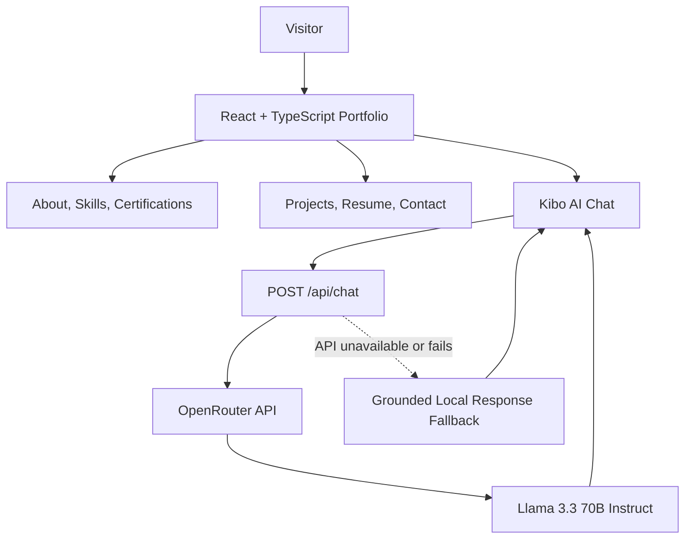

✨ Ankita Behera — AI Engineer & ML Systems Developer
A personal portfolio website showcasing my work across Artificial Intelligence, Machine Learning, Generative AI, NLP, Retrieval-Augmented Generation (RAG), and agentic systems. The site combines an editorial, warm-cream visual design with scroll-based motion and Kibo, an AI portfolio assistant that helps visitors explore my projects, skills, and certifications.

  <a href="https://ankitabehera888.vercel.app/"><strong>🌐 View Live Portfolio</strong></a> ·
  <a href="https://github.com/ankitabehera888/MY_PORTFOLIO"><strong>📂 Source Code</strong></a> ·
  <a href="https://www.linkedin.com/in/ankita-behera-327446400/"><strong>💼 LinkedIn</strong></a>

Project Overview
The portfolio is designed as a single-page experience where visitors can learn about my background, explore technical skills and certifications, review selected projects, access my resume, and get in touch. It focuses on presenting engineering work clearly rather than relying on a generic template.

The interface is built with React and TypeScript, styled with Tailwind CSS, and animated with Framer Motion. A serverless API powers Kibo's OpenRouter-backed responses while a grounded local response engine provides a fallback when the API is unavailable.
System Architecture

How It Works
1. Portfolio interface — React components render the navigation, hero, about, skills, certifications, projects, resume, contact section, and footer.
2. Motion and interaction — Framer Motion powers entrance and scroll-reveal animations. A custom Pearl Drift cursor effect creates a subtle particle trail on supported desktop devices.
3. Portfolio content — Skills, project details, certifications, and personal profile information are organized in reusable data modules.
4. Kibo AI assistant — Visitors can ask questions about the portfolio. The frontend sends conversation messages to the /api/chat serverless endpoint.
5. AI response handling — The serverless handler calls OpenRouter using the meta-llama/llama-3.3-70b-instruct model. If the API endpoint is unavailable or the request fails, the client can fall back to grounded portfolio responses.
   
Run Locally
Prerequisites
- Node.js and npm installed.
- An OpenRouter API key if you want Kibo to use the hosted LLM endpoint.
1. Clone the repository
git clone https://github.com/ankitabehera888/MY_PORTFOLIO.git
cd MY_PORTFOLIO
2. Install dependencies
npm install
3. Start the frontend
npm run dev
Open the local URL printed by Vite in your terminal.
4. Configure Kibo's API key
The chatbot's API key must be configured on the server side. Copy .env.example to .env.local and replace the placeholder with your own key:
OPENROUTER_API_KEY=your_openrouter_api_key_here
Create an API key at OpenRouter. Never put this secret in a VITE_ variable or commit a real API key to GitHub.
Local development note: npm run dev starts Vite's frontend server; it does not by itself run the Vercel serverless function in api/chat.ts. To test the serverless chatbot endpoint locally, use the Vercel CLI (vercel dev) with the project linked/configured and the environment variable available to that runtime. The portfolio's grounded fallback can respond when the API is unavailable.

Deploy to Vercel
1. Import ankitabehera888/MY_PORTFOLIO into Vercel.
2. Keep the root directory as ./ and allow Vercel to detect Vite, or use the following settings:
   - Build command: npm run build
   - Output directory: dist
3. In Project Settings → Environment Variables, add OPENROUTER_API_KEY for the environments you intend to use.
4. Redeploy after adding or changing environment variables.
5. Open the production domain and test navigation, resume downloads, contact flow, and Kibo.
Live site: ankitabehera888.vercel.app
Available Scripts
Command	Description
npm run dev	Starts the Vite development server
npm run build	Runs the TypeScript build checks and creates the production bundle
npm run preview	Serves the built frontend locally for preview
npm run lint	Runs Oxlint

Future Improvements
- Add automated component and end-to-end tests.
- Continue refining accessibility, keyboard navigation, and reduced-motion behavior.
- Add richer project case studies and visual demonstrations as projects evolve.
- Add monitoring for chatbot API failures and usage limits.
License
No explicit license has been added to this repository. Unless a LICENSE file is added, the code should not be assumed to be available for unrestricted reuse or redistribution.
About
Ankita Behera — Computer Science and Engineering undergraduate at NIST University, interested in applied AI/ML, Generative AI, NLP, RAG, and agentic systems.
- Portfolio: https://ankitabehera888.vercel.app/
- GitHub: https://github.com/ankitabehera888
- LinkedIn: https://www.linkedin.com/in/ankita-behera-327446400/
